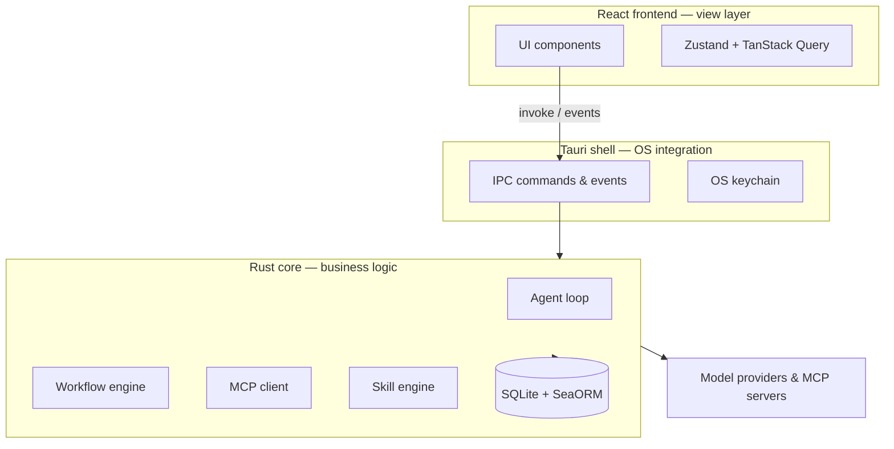

<div align="center">
  
  <p>
    <strong>A local-first desktop AI orchestration platform for developers whose code can't leave the machine.</strong><br/>
    SkillDeck brings branching conversations, multi-agent workflows, filesystem-based skills, and the Model Context Protocol into one native app: a Rust core, a React view layer, and SQLite storage, with no Electron and no cloud dependency. It's for developers who want the leverage of AI coding agents without the data exposure of cloud assistants. Every external tool call passes an approval gate, and every skill is a version-controlled Markdown file.
  </p>
  <p>
    <a href="#status"></a>
    <a href="LICENSE.md"></a>
    <a href="#prerequisites"></a>
    <a href="src-tauri/skilldeck-core/"></a>
    <a href="https://tauri.app"></a>
  </p>
  <p>
    <a href="#quickstart">Quickstart</a> •
    <a href="#features">Features</a> •
    <a href="#architecture">Architecture</a> •
    <a href="#usage">Usage</a> •
    <a href="#status">Status</a>
  </p>
</div>

## Quickstart

Requires Rust (stable, Edition 2024), Node.js 20+, pnpm 10+, and the [Tauri prerequisites](https://tauri.app/start/prerequisites/) for your platform.

```bash
git clone https://github.com/elcoosp/skilldeck.git
cd skilldeck
pnpm install
pnpm tauri dev
```

The app launches into the conversation view; you're ready to start your first thread. On first launch, SkillDeck runs database migrations and seeds a default profile, model pricing entries, and skill source directories.

> [!NOTE]
> Optional local models via [Ollama](https://ollama.com). The app works without it; Ollama just shows up as one more provider in the model picker.

## Features

- **Local by default.** Rust core, SQLite with WAL mode, API keys in the OS keychain (macOS Keychain, Windows Credential Manager, libsecret). Zero Electron, zero cloud dependency, cloud features strictly opt-in.
- **Branching conversations.** Fork any message and compare branches side-by-side, without losing the parent thread.
- **Multi-agent workflows.** Sequential, Parallel, and Evaluator-Optimizer DAGs, validated with `petgraph` and visualized with React Flow.
- **Filesystem-based skills.** `SKILL.md` packages with YAML frontmatter, priority resolution (workspace > personal > registry), and a 17-rule linter that reports security and quality scores (1–5).
- **MCP, implemented in full.** stdio and SSE transports, JSON-RPC 2.0 over protocol `2024-11-05`, 30-second health checks, and exponential-backoff restarts (1s → 2s → 4s → … max 60s, 5 attempts).
- **Approval gates on every external tool call.** Approve, edit parameters, or deny; all six auto-approve categories default to off.
- **Multi-provider and token-efficient.** Claude, OpenAI, and Ollama behind a single loop; TOON encoding cuts payload tokens by roughly 40% versus JSON.

## Architecture

SkillDeck is a reactive, event-driven state machine with three layers. The core has zero Tauri dependencies, so it's testable in isolation and portable to CLI or server contexts.



The agent loop runs as a streaming async cycle: persist the user message → build context (history + active skills + workspace) → call the provider → stream tokens through a ring buffer and 50 ms debounce → dispatch tool calls through the approval gate → persist the assistant reply and emit `done` → auto-process the next queued message.

## Usage

### Skills

A skill is a directory containing a `SKILL.md` with YAML frontmatter. Skills live in `<workspace>/.skilldeck/skills/`, `~/.agents/skills/`, or the registry cache, resolved in that priority order.

```yaml
---
name: code-review
description: "Review code for bugs, security issues, and style violations"
compatibility: ["claude-3", "gpt-4"]
allowed_tools: ["read_file", "list_directory"]
---
# Code Review

## Instructions
1. Read the target file.
2. Check for null-access patterns and missing error handling.
3. Report findings grouped by severity (HIGH / MED / LOW).
```

Run the linter standalone with `skilldeck-lint path/to/skill/`.

### Workflows

| Pattern | When to use |
| --- | --- |
| **Sequential** | Each step depends on the previous one; steps run in topological order. |
| **Parallel** | Independent steps run concurrently using Tokio's `JoinSet`. |
| **Evaluator-Optimizer** | Iterative refinement: generator produces, evaluator scores, repeat until threshold or max iterations. |

## Status

> [!NOTE]
> SkillDeck is in **beta**. Core features are complete and the app is usable for daily work; the current focus is stability, ecosystem growth, advanced workflow patterns (Map-Reduce, DAG merging), and team features. See the [v2 roadmap](docs/design/v2-roadmap.md) for the plan through 2026.

## Learn more

- [User documentation](https://docs.skilldeck.dev) — guides and tutorials
- [Architecture overview](ARCHITECTURE.md)
- [Specifications](docs/spec/) — vision, BRS, SRS, test verification
- [Design documents](docs/design/) — UX, tech stack, project structure
- [Skill format](https://agentskills.io)
- [Security policy](SECURITY.md)
